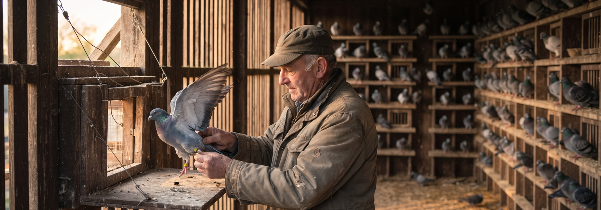

# codeintel-Dependency-Update-Notifier

Title block: the name above is set in Baumans in plankton green on a pale panel ruled like a log page. One small glass sponge stands beside this title as the marker for this repo, at punctuation size everywhere else.

Scans project dependencies and notifies the user if there are newer versions available, potentially including security updates. Uses `pip` and `packaging`. - Focused on Tools for static code analysis, vulnerability scanning, and code quality assurance

Every run prints a closing summary with probed, updated, and unknown counts. The run exits 1 when any checked package ended unknown. The line saying all dependencies are up to date is printed only when every checked package was probed successfully and none has an update waiting. Under --check-security, the run exits 1 when the safety tool is missing or the safety run itself fails.

> **Dive log remark: unknown is a result.** The summary counts are probed, updated, and unknown. Any checked package ending unknown ends the run at exit 1. Under the security flag, safety findings, return code 1, count as a finished check, not a failed safety run.

## Install
`git clone https://github.com/ShadowStrikeHQ/codeintel-dependency-update-notifier`

> **Dive log remark: clone line flagged.** The install line above reads git clone https://github.com/ShadowStrikeHQ/codeintel-dependency-update-notifier. The organisation in it is wrong; the organisation is ShadowGuard-AI. The line is preserved as printed and flagged here, not fixed in place.

## Usage
`./codeintel-dependency-update-notifier [params]`

> **Dive log remark: usage line flagged.** The usage line above is a placeholder. No such entry point and no such argument exist. The true invocation from the parser in main.py is shown on the website at full size, with this printed line shown small and labelled beside it.

## Parameters
- `-h`: Show help message and exit
- `-r`: Path to the requirements.txt file.
- `-p`: Path to the project directory. Defaults to current directory.
- `-v`: Enable verbose logging.
- `--check-security`: Check for known security vulnerabilities using safety.

> **Dive log remark: requirements rule, stated beside the list, not inside it.** A requirements file supplies names only: specifiers, extras, and markers are dropped, and an unreadable file ends the run at exit 1 with no fallback to checking everything. That fact is a fact of the code, recorded on the website.

## License
Copyright (c) ShadowStrikeHQ

> **Dive log remark: closing line flagged.** The closing line above reads Copyright (c) ShadowStrikeHQ, the same wrong organisation as the clone line. The repository LICENSE file carries the MIT License. Both facts stand as printed.
